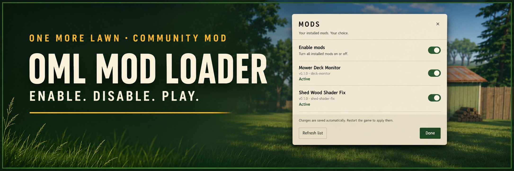
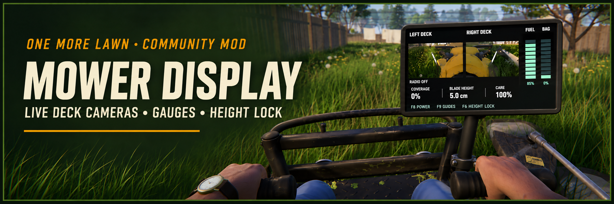
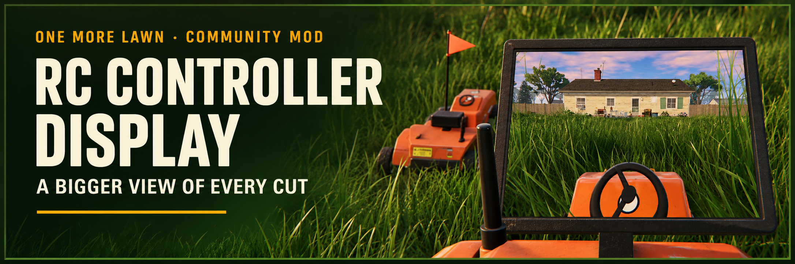

# One More Lawn — Mod Loader and Mods | Unofficial OML ModLoader and mods made by N0M4DCode

Community loader and optional display mods for the Windows Steam edition.

**Back up saves before running mods. Install OML Mod Loader first.**

[Downloads](https://github.com/N0M4Dcode/One-More-Lawn-Mod-Loader-And-Mods/releases) · [Install/uninstall guide](https://github.com/N0M4Dcode/One-More-Lawn-Mod-Loader-And-Mods/wiki/OML-Mod-Loader) · [Wiki](https://github.com/N0M4Dcode/One-More-Lawn-Mod-Loader-And-Mods/wiki)

| Component | Version | Suggested release tag |
| --- | --- | --- |
| OML Mod Loader | 0.2.0 alpha | loader-v0.2.0 |
| Mower Display | 0.2.0 alpha | mower-display-v0.2.0 |
| RC Controller Display | 0.1.0 alpha | rc-display-v0.1.0 |

Each component is distributed separately. Download the named ZIP from release Assets, not GitHub’s automatic source archives.

The loader adds main-menu mod switches. Mower Display adds deck cameras, gauges and blade-height lock. RC Controller Display enlarges the native RC camera screen.

See [save backups](https://github.com/N0M4Dcode/One-More-Lawn-Mod-Loader-And-Mods/wiki/Save-Backups) before installing.

## Available mods

### OML Mod Loader

Required loader. Install this first, then enable your addons from the main-menu Mods panel.

[Installation and removal instructions](https://github.com/N0M4Dcode/One-More-Lawn-Mod-Loader-And-Mods/wiki/OML-Mod-Loader)

### Mower Display

Live deck cameras, gauges, mowing information and blade-height lock.

[Installation and removal instructions](https://github.com/N0M4Dcode/One-More-Lawn-Mod-Loader-And-Mods/wiki/Mower-Display)

### RC Controller Display

A larger live camera screen on the handheld RC controller.

[Installation and removal instructions](https://github.com/N0M4Dcode/One-More-Lawn-Mod-Loader-And-Mods/wiki/RC-Controller-Display)
